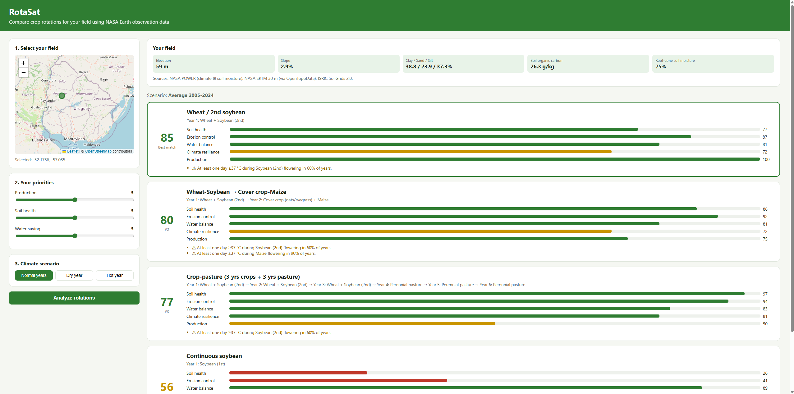
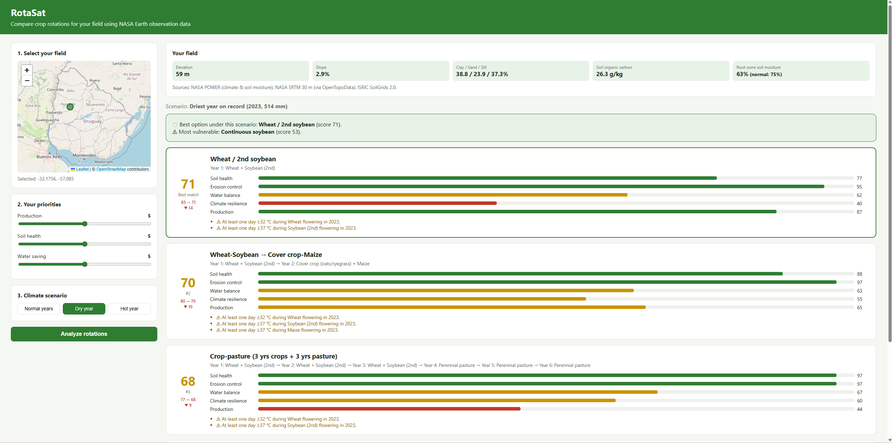
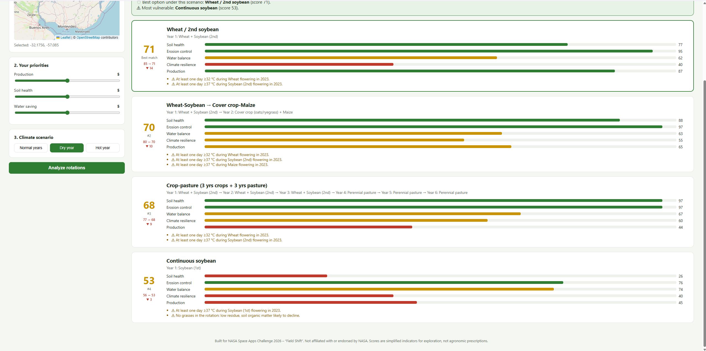

# RotaSat 🌱🛰️

**Compare crop rotations for your field using NASA Earth observation data.**

Built for the **NASA Space Apps Challenge 2026** – challenge _“Field Shift: Adapting Farms with NASA Data”_.
Team **Salva y Lea** (Montevideo, Uruguay).

🔗 **Live demo:** https://field-shift-uy.vercel.app

> Note: the backend runs on a free hosting tier. If the app has been idle, the first analysis may take up to a minute while the server wakes up.

## Screenshots

**Normal years – rotation ranking for a field in Paysandú**


**Dry year stress test (2023 drought) – score drop vs. normal years**


**Explainable warnings for each rotation**


---

## The problem

Farmers in Uruguay face shifting temperatures, irregular rainfall and soil degradation. The 2022–2023 drought was one of the most severe in the country's recent history, and continuous soybean cropping has been associated with soil erosion and loss of organic matter. Choosing a crop rotation is a long-term decision, but farmers rarely have an easy way to see how different rotations would perform **on their own field**, under **their own climate**, and according to **their own priorities**.

## What RotaSat does

1. **Select your field** by clicking on a map.
2. **Set your priorities** (production, soil health, water saving).
3. **Pick a climate scenario**: normal years, the driest year on record, or the hottest year on record.
4. Get a **ranking of four typical Uruguayan crop rotations**, with a score for each criterion and plain-language warnings (e.g. _“At least one day ≥37 °C during soybean flowering in 2023”_).

In stress scenarios, each rotation shows how much its score drops compared with normal years, and the app highlights the best option and the most vulnerable one.

### Rotations compared

| Rotation                         | Description                                                       |
| -------------------------------- | ----------------------------------------------------------------- |
| Continuous soybean               | Soybean every summer, bare soil in winter                         |
| Wheat / 2nd soybean              | Winter wheat followed by second-crop soybean                      |
| Wheat-Soybean → Cover crop-Maize | Two-year rotation adding a winter cover crop and maize            |
| Crop-pasture                     | 3 years of wheat/soybean followed by 3 years of perennial pasture |

## NASA data used

| Dataset                                                                      | What we use it for                                                                                                                                                                                                                     |
| ---------------------------------------------------------------------------- | -------------------------------------------------------------------------------------------------------------------------------------------------------------------------------------------------------------------------------------- |
| **NASA POWER** (Agroclimatology, monthly, 2005–2024)                         | Rainfall (`PRECTOTCORR`), mean temperature (`T2M`), monthly extreme max/min temperature (`T2M_MAX`, `T2M_MIN`) for the selected point. Drives the water balance, heat-stress and frost-risk indicators and the dry/hot year scenarios. |
| **SRTM** (Shuttle Radar Topography Mission, 30 m)                            | Elevation and terrain slope of the field (accessed via the OpenTopoData API). Drives the erosion indicator.                                                                                                                            |
| **NASA POWER – Root-zone soil wetness** (`GWETROOT`, from NASA GMAO MERRA-2) | Soil moisture available to roots during each crop season. Combined with rainfall in the water balance score and used for low-moisture warnings.                                                                                        |

### Other data and resources

- **ISRIC SoilGrids 2.0** – soil texture (clay, sand, silt) and soil organic carbon, 0–30 cm. Used because the soil datasets suggested in the challenge (SSURGO, Web Soil Survey) only cover the United States.
- **OpenStreetMap** + **Leaflet** – base map.
- **FAO-56** crop water requirement guidelines and regional literature – indicative crop parameters.

## How the scores work

Each rotation receives a 0–100 score on five criteria. All formulas are intentionally simple and transparent so that every number can be explained to a farmer.

| Criterion              | Based on                                                                                                                                                                             |
| ---------------------- | ------------------------------------------------------------------------------------------------------------------------------------------------------------------------------------ |
| **Soil health**        | Months per year the soil is covered, crop residue returned, share of grasses in the rotation, and presence of perennial pasture.                                                     |
| **Erosion control**    | Simplified RUSLE-inspired index: rainfall × slope (SRTM) × soil erodibility (silt and organic carbon from SoilGrids) × bare-soil factor.                                             |
| **Water balance**      | Rainfall during each crop's season (NASA POWER) and root-zone soil moisture (NASA POWER / MERRA-2) vs. the crop's water requirement, plus total yearly water demand of the rotation. |
| **Climate resilience** | Frequency of extreme heat (monthly max ≥ crop threshold) during flowering, and frost (monthly min < 0 °C) for frost-sensitive crops.                                                 |
| **Production**         | Grain harvests per year, adjusted by water availability.                                                                                                                             |

The **final score** is a weighted average of these criteria using the farmer's priority sliders (climate resilience always has a fixed weight).

### Climate scenarios

- **Normal years** – average of all years 2005–2024.
- **Dry year** – the year with the lowest annual rainfall at that location (typically 2023 in Uruguay).
- **Hot year** – the year with the highest mean temperature at that location.

## Limitations

RotaSat is an **exploration and decision-support tool, not an agronomic prescription**.

- Crop parameters are indicative and simplified; they are not calibrated per variety or management system.
- Monthly data is used; crop seasons that span two calendar years are evaluated within the same calendar year.
- `T2M_MAX`/`T2M_MIN` are monthly extremes, so heat/frost indicators reflect _at least one extreme day_ in the month.
- Soil data comes from a global model (SoilGrids) at ~250 m resolution, not from field sampling.
- Economic factors (prices, costs, markets) are not included yet.
- Version 1 is focused on Uruguay: field selection is limited to the country, and the rotations compared are typical Uruguayan systems.

## Future work

- Add **SMAP** soil moisture and **GPM IMERG** rainfall.
- Integrate Uruguayan soil data (MGAP CONEAT / soil maps) and connect with Uruguay's mandatory _Soil Use and Management Plans_.
- Let farmers define custom rotations and include economic margins.
- Daily-resolution heat and frost analysis.

## Tech stack

- **Frontend:** React + Vite, Leaflet / react-leaflet (deployed on Vercel)
- **Backend:** Node.js + Express (deployed on Render)
- **APIs:** NASA POWER, OpenTopoData (SRTM), ISRIC SoilGrids

## Run locally

Requires Node.js 18+.

```bash
# Backend
cd server
npm install
npm run dev        # http://localhost:3001

# Frontend (in another terminal)
cd client
npm install
npm run dev        # http://localhost:5173
```

API example: `GET /api/analyze?lat=-33.5&lon=-57.8&production=5&soil=5&water=5&scenario=dry`

## Use of AI

AI tools were used during development. **Claude (Anthropic)** assisted with structuring the architecture, generating parts of the code (backend services, scoring engine and frontend components) and drafting documentation. The team defined the idea and approach, reviewed, tested and adjusted all code, and validated the results. No AI-generated images, video or audio are included in the project.

## Team

**Salva y Lea** – IT students at Universidad ORT Uruguay

- Salvador Espiga
- Leandro Ratto

## References

- NASA POWER Project – https://power.larc.nasa.gov
- NASA Shuttle Radar Topography Mission (SRTM) – https://www.earthdata.nasa.gov/data/instruments/srtm
- OpenTopoData – https://www.opentopodata.org
- Poggio, L. et al. (2021). SoilGrids 2.0. _SOIL_, 7, 217–240. – https://soilgrids.org
- Allen, R. G. et al. (1998). _Crop evapotranspiration (FAO Irrigation and Drainage Paper 56)_. FAO.
- Renard, K. G. et al. (1997). _Predicting Soil Erosion by Water: RUSLE_. USDA Agriculture Handbook 703.

## License

MIT

_Not affiliated with or endorsed by NASA._
